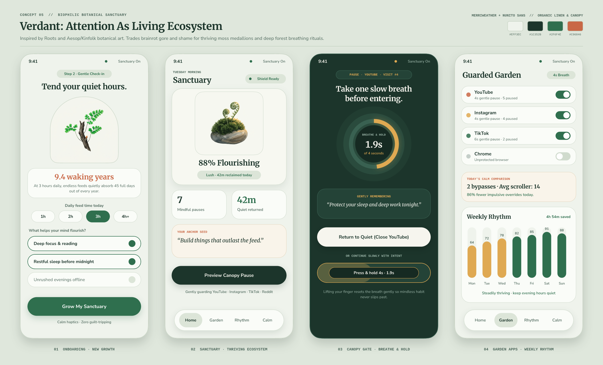

# RotGuard

An Android app that puts a calm, deliberate pause between you and the apps you reach for on autopilot. Built for students and working professionals who want their hours back.

When you open an app you've chosen to guard (YouTube, Instagram, TikTok…), RotGuard shows a pause screen with one of your own reminders and photos. You can close the app with one tap, or press and hold for a few seconds to continue on purpose. Choosing to close plays one of 50 small celebrations.

> **A note on this codebase**
>
> This code is **not** written the way I would write it by hand, or for other humans to read. It's optimised for **AI coding agents** to work in efficiently. That means long, search-friendly names, heavy KDoc on every boundary, rigidly repeated patterns, small self-contained files, duplication over shared abstractions, and pure functions everywhere a test can reach. The rules are in [`gemini.md`](gemini.md). If something looks verbose or repetitive, it's probably on purpose.



## Features

- **Pause screen:** shows over guarded apps through an accessibility service plus an overlay window. A padlock with a 1-second countdown stops reflex taps, then you press and hold to continue.
- **Auto-close:** if you just stare at the pause screen for 15 seconds, it closes the app for you.
- **Breaks:** the second time you hit the pause screen for the same app within 5 minutes, you can skip pausing it for 30 min, 1 hr or 2 hr. You can end a break early from Home.
- **50 celebrations:** closing an app plays one of 50 named animations (particles, emblems, palettes). All 50 play before any repeats.
- **Inspiration:** personal reminders plus photos (9 built-in scenes you can show or hide, plus your own gallery photos, several at a time) shown on the pause screen.
- **Home:** Focus Health, urges stopped and time saved, with numbers that count up. Insights gives a 7-day view. "Test" pause screens never count toward your stats.
- **Guided permission setup:** narrated picture-in-picture tutorial videos float over Android Settings. There are variants for Android 8–10, 11+ and 16+, and for apps installed from a file on Android 13+ (the "Restricted setting" unlock).
- **5 languages:** English, Spanish, Simplified Chinese, Hindi and Arabic (right-to-left), including the tutorial videos.
- **Calm onboarding:** slow typewriter text with a soft typing sound, haptic feedback on button presses, and an animated splash.

## Tech

Kotlin 2.1 · Jetpack Compose (BOM 2025.02) · Material 3 · Hilt · Room · Coroutines/Flow · AGP 8.9 · `minSdk 26`, `targetSdk 36` · detekt · JUnit + Turbine.

Gradle runs on **JDK 21**. `gradle/gradle-daemon-jvm.properties` pins the daemon, so a newer IDE JDK (e.g. Android Studio's bundled 25) still works.

## Architecture in one screen

```
app/src/main/java/com/rotguard/app/
├── feature/<slice>/          one folder per feature: dashboard, apps, insights, settings,
│   ├── XContract.kt          inspiration, onboarding, shield, tutorial
│   ├── XReducer.kt           pure (state, event) -> state; unit-tested, no Android imports
│   ├── XViewModel.kt         single StateFlow<UiState>, linear suspend side effects
│   ├── XRepository.kt        Room / system access behind an interface (faked in tests)
│   └── XScreen.kt            stateless Composable(state, onAction)
├── designsystem/             Verdant palette, shared components, choreography, splash/haptics helpers
└── storage/                  Room entities, DAOs, migrations, value classes, starter content
```

- **Vertical slices, locality over DRY:** everything a feature needs lives in its folder, and small helpers are duplicated rather than shared.
- **Unidirectional data flow:** Screen → `Action` → ViewModel → `InternalEvent` → pure Reducer → new `UiState`. Side effects (Room, haptics, navigation `Effect`s) stay in the ViewModel or controller.
- **Typed state:** sealed `UiState` / `Action` / `Event` hierarchies, plus `@JvmInline value class`es for IDs, times and percentages.
- **The shield:** `AppGuardAccessibilityService` → `ShieldReducer.evaluateForegroundTransition` (pure) → `FrictionSessionController` (hold timer, idle auto-close, celebration, breaks) → `FrictionOverlayWindow`.

## Build & run

```bash
./gradlew installDebug            # build + install on a connected device/emulator
./gradlew testDebugUnitTest detekt  # the verification loop every change must pass
```

After installing, open RotGuard and follow onboarding. It walks you through the three special permissions (Accessibility, Display over other apps, Usage access) with tutorial videos.

## Tools

- `tools/tutorials/`: renders the permission tutorial videos from `scene.html` with Gemini TTS narration (`node tools/tutorials/render.mjs [--lang es,zh-CN,hi,ar]`; needs `GEMINI_API_KEY`).
- `design/`: the design explorations and the procedural generators for the stock Inspiration scenes.
